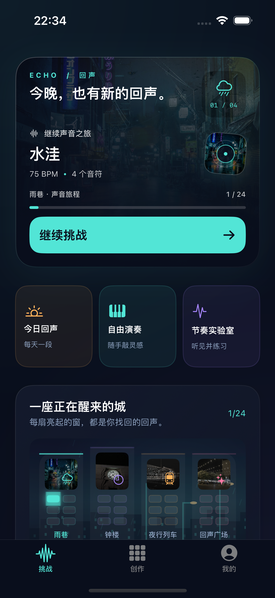
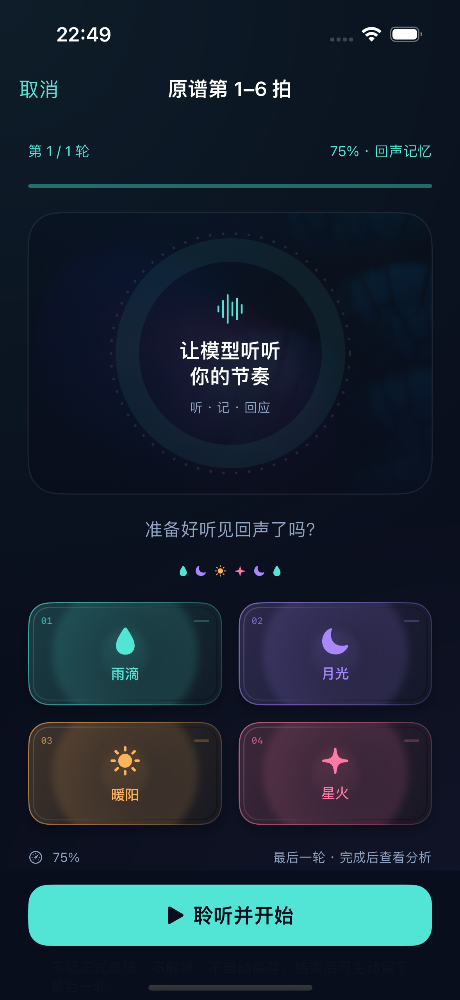
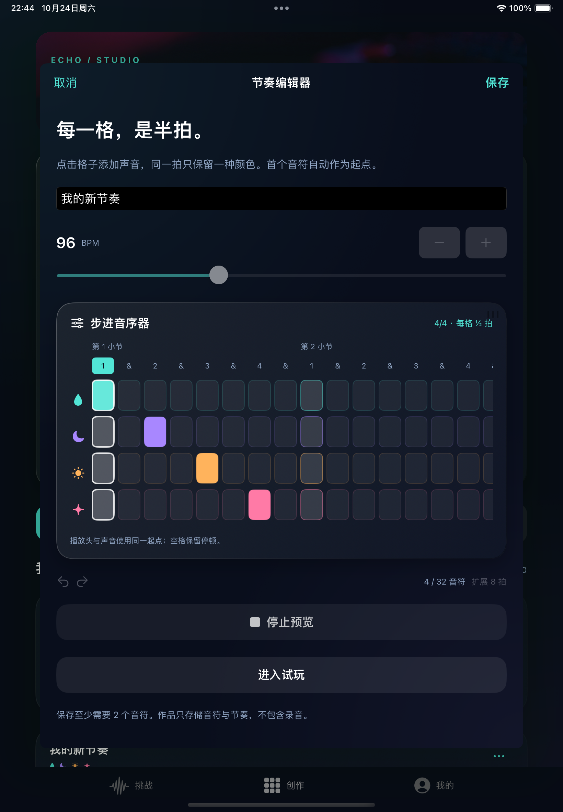

# 回声 Echo

一款离线运行的 iPhone / iPad 节奏记忆游戏。先听一段示范，再用四个音垫复现顺序和间隔，也可以自己编一段节奏。

## 页面预览

<p>
  
  
</p>



## 玩法与功能

- 四章 24 关，包含回声记忆、同步跟奏和消失节拍。
- 每日回声、节奏接龙、同机双人，以及本地进度记录。
- 自由敲击和网格编曲，支持保存、修改、复制及 JSON 导入导出。
- 标准节奏与实际演奏 A/B 回放、片段循环、慢速练习和逐级提速。
- 节奏档案，比较同谱面、同玩法、同速度的演奏记录。
- SNN 节奏实验室，展示脉冲编码、LIF 神经元状态和规则 / ANN / SNN 对照。

四种音色由程序合成，没有使用商业歌曲或游戏谱面。主要功能不需要联网、账户或麦克风权限。

## 运行

需要 macOS、Xcode 15.4 或更新版本，目标系统为 iOS / iPadOS 17.5 或更新版本。

1. 打开 `Echo.xcodeproj`。
2. 选择 `Echo` Scheme 和 iPhone / iPad 模拟器，运行项目。
3. 如果安装到自己的设备，在 Signing & Capabilities 中选择自己的开发团队；必要时修改 Bundle Identifier。

App 运行不需要 Python 或下载模型。两份运行权重已经包含在 `Echo/Resources` 中。

## 节奏实验室

模型分析的是相邻点击间隔相对标准的偏差，分为稳定、整体偏快、整体偏慢和间隔不稳。输入误差重采样为 16 个位置，正负分路编码为 32 路脉冲；SNN 使用 32 个计算步和 48 个 LIF 神经元。Swift 直接执行离线推理，不依赖 Core ML。

规则、ANN 和 SNN 在同一受控合成测试集上均达到 100% 准确率、宏 F1 为 1.000。基准没有真人验证样本，因此这一结果不能代表实际玩家准确率，也不能说明 SNN 更优或更省电。模型意见与正式游戏成绩分开。

探索模式的衰减和阈值滑块不会改写正式权重。档案需要主动保存，人工标签与模型预测分别记录。

训练脚本、依赖和基准结果在 `节奏实验资料/`，编码、适用范围与训练方法见其中的 `实验说明.txt`。

## 项目结构

```text
Echo/
  Models/            节奏和实验数据结构
  Services/          游戏、声音、存储与模型推理
  UI/                SwiftUI 页面和绘制
  Resources/         ANN、SNN 运行权重
  Assets.xcassets/   图标、摄影与效果贴图
Echo.xcodeproj/      Xcode 工程和共享 Scheme
节奏实验资料/        离线训练脚本与合成基准
素材许可/            第三方素材来源与许可
docs/                页面截图
```

## 数据与素材

作品、进度和主动保存的实验记录存储在本机，卸载前请导出重要数据。实验记录 JSON 与创作关卡 JSON 用途不同，不能互相导入。

摄影来自 Unsplash，纹理和贴图来自 ambientCG、Kenney。它们各自适用 Unsplash License 或 CC0，具体来源与许可保留在 `素材许可/`，不因仓库公开而改变。源代码尚未指定开源许可证。
